## Procedure — Lab 2: Conti Ransomware Investigation

Scenario: Employees could not log into Outlook and the Exchange admin was locked out of the Exchange Admin Center. Ransom note files (readme.txt) were found on the Exchange server. Splunk was used to trace the attacker's activity via Sysmon, Windows Security, and IIS logs.

### Step 1 — Locate the ransomware binary

Searched Sysmon logs for executable activity, then tabled CurrentDirectory against Image and de-duplicated to spot a legitimate binary (cmd.exe) sitting in an unusual user folder.

```spl
index=* sourcetype="WinEventLog:Microsoft-Windows-Sysmon/Operational" "*.exe*"
| table CurrentDirectory, Image
| dedup CurrentDirectory
```

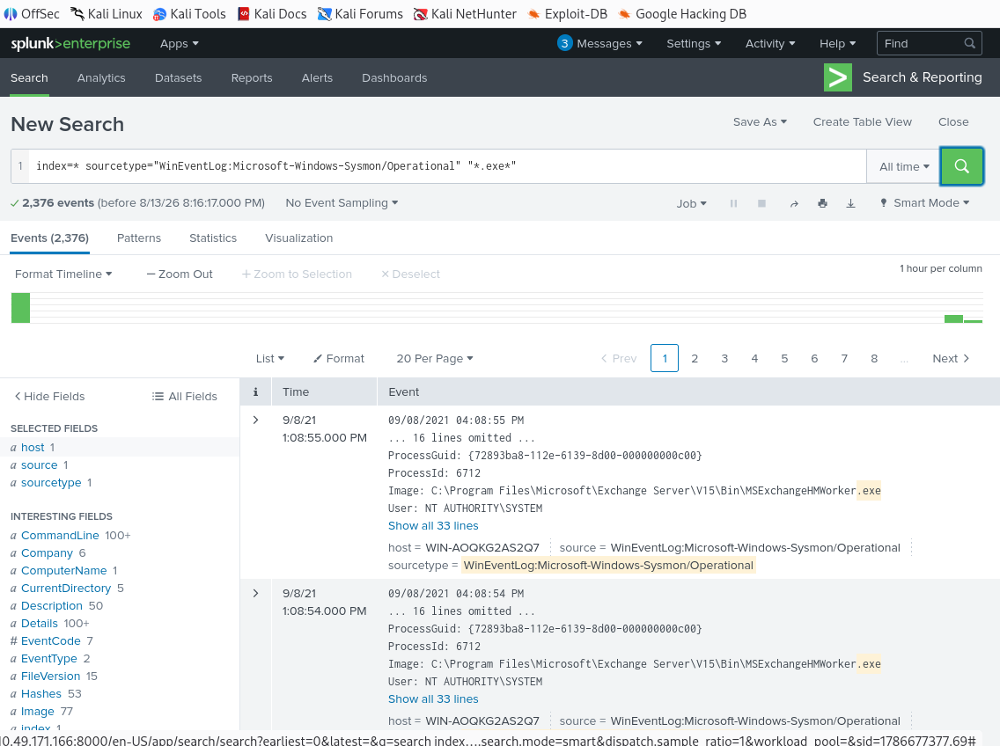
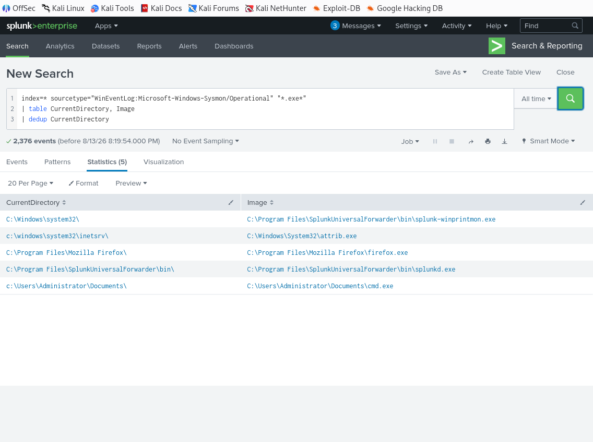
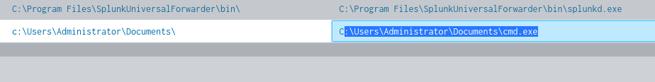

**Q1. Can you identify the location of the ransomware?**
Answer: `C:\Users\Administrator\Documents\cmd.exe`

**Q2. What is the Sysmon event ID for the related file creation event?**
Answer: `11 (FileCreate)`

---

### Step 2 — Retrieve the MD5 hash

Filtered Sysmon logs using a wildcard match for the disguised cmd.exe image. The first matching event turned out to be a FileCreate (EventCode=11) event rather than a Process Create event, so the search was narrowed to EventCode=1 to locate the Hashes field.

```spl
index=* sourcetype="WinEventLog:Microsoft-Windows-Sysmon/Operational" Image="*Documents\\cmd.exe*"
```

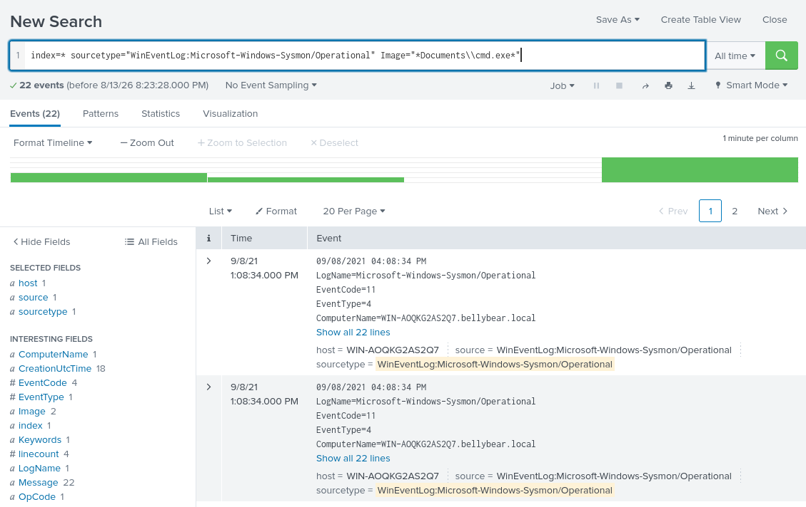
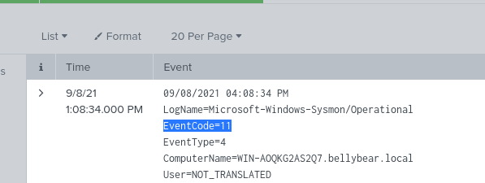
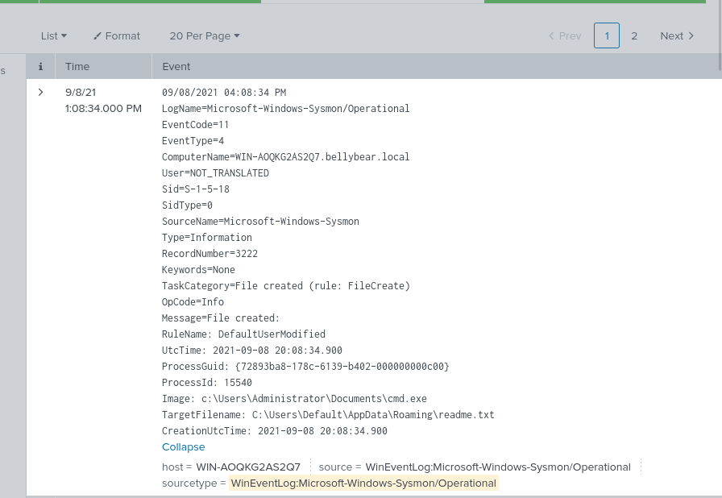
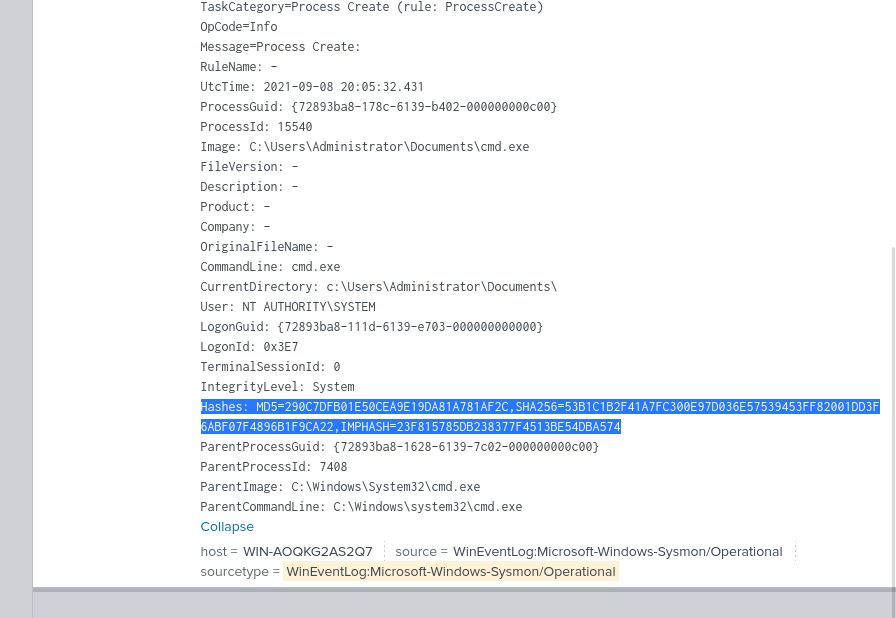

**Q3. Can you find the MD5 hash of the ransomware?**
Answer: `290C7DFB01E50CEA9E19DA81A781AF2C`

---

### Step 3 — Identify the ransom note dropped in multiple locations

Filtered FileCreate events (EventCode=11) for readme.txt and tabled Image against TargetFilename.

```spl
index=* sourcetype="WinEventLog:Microsoft-Windows-Sysmon/Operational" EventCode=11 TargetFilename="*readme.txt*"
| table Image, TargetFilename
```

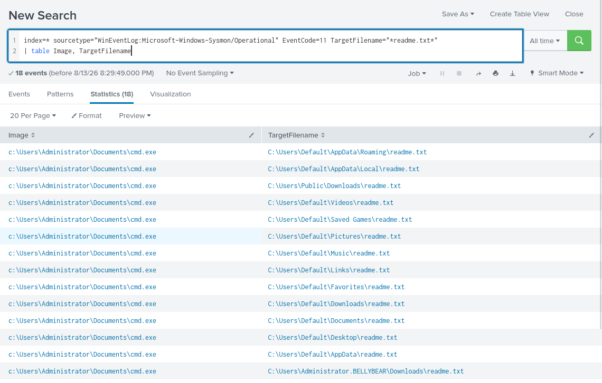

**Q4. What file was saved to multiple folder locations?**
Answer: `readme.txt`

---

### Step 4 — New user account creation

Searched Windows Security Event ID 4720 (user account created), identified the new account (securityninja), then located the exact net user command used.

```spl
index=* EventCode=4720
```

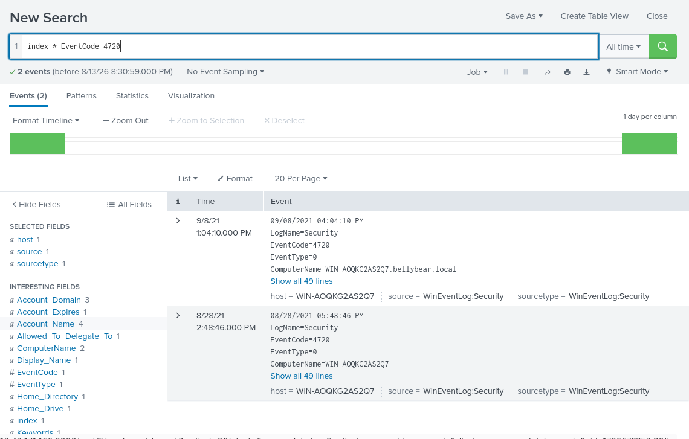
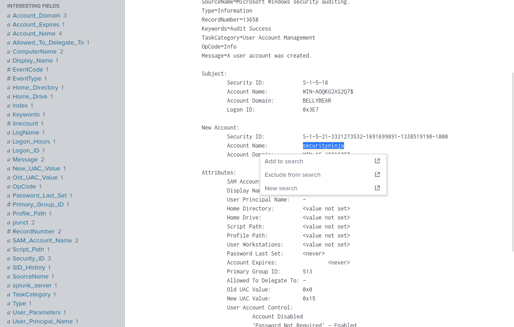

Follow-up search for the exact command line:

```spl
index=* "securityninja"
```

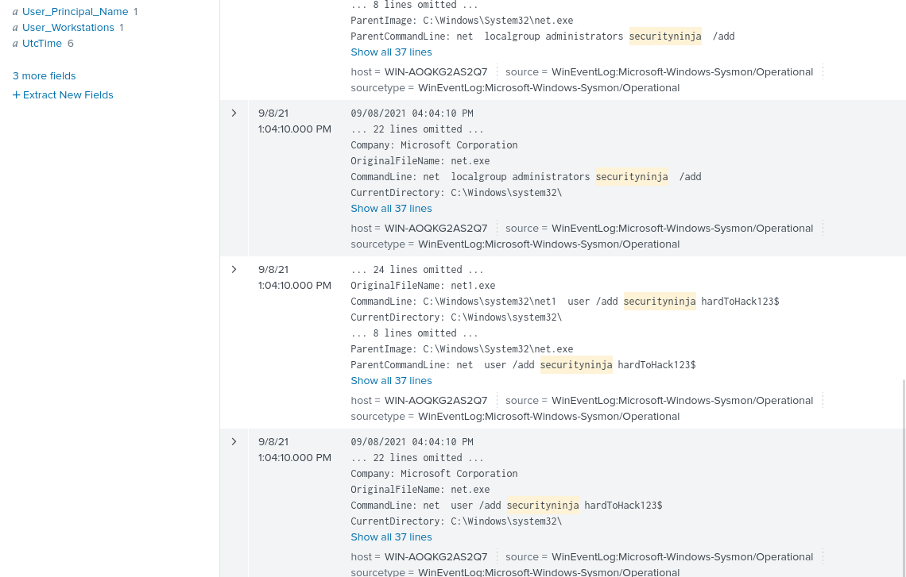

**Q5. What was the command the attacker used to add a new user to the compromised system?**
Answer: `net user /add securityninja hardToHack123$`

---

### Step 5 — Process migration for persistence

Searched Sysmon Event ID 8 (CreateRemoteThread) and tabled SourceImage against TargetImage to trace the process injection chain.

```spl
index=* sourcetype="WinEventLog:Microsoft-Windows-Sysmon/Operational" EventCode=8
| table SourceImage, TargetImage
```

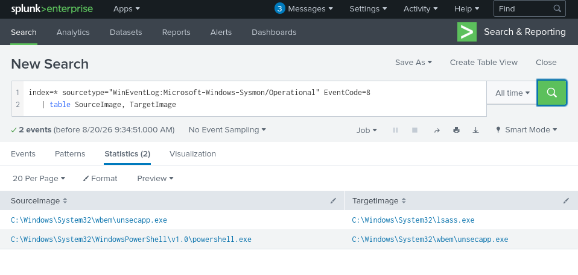

**Q6. The attacker migrated the process for better persistence. What is the migrated process image, and what is the original process image?**
Answer: Original: `C:\Windows\System32\WindowsPowerShell\v1.0\powershell.exe` | Migrated: `C:\Windows\System32\wbem\unsecapp.exe`

**Q7. The attacker also retrieved the system hashes. What is the process image used for getting the system hashes?**
Answer: `C:\Windows\System32\lsass.exe`

---

### Step 6 — Identify the deployed web shell

Searched Sysmon logs for .aspx activity, confirming attrib.exe was used to remove the read-only flag from a web shell file in the OWA auth directory.

```spl
index=* sourcetype="WinEventLog:Microsoft-Windows-Sysmon/Operational" "*.aspx*"
```

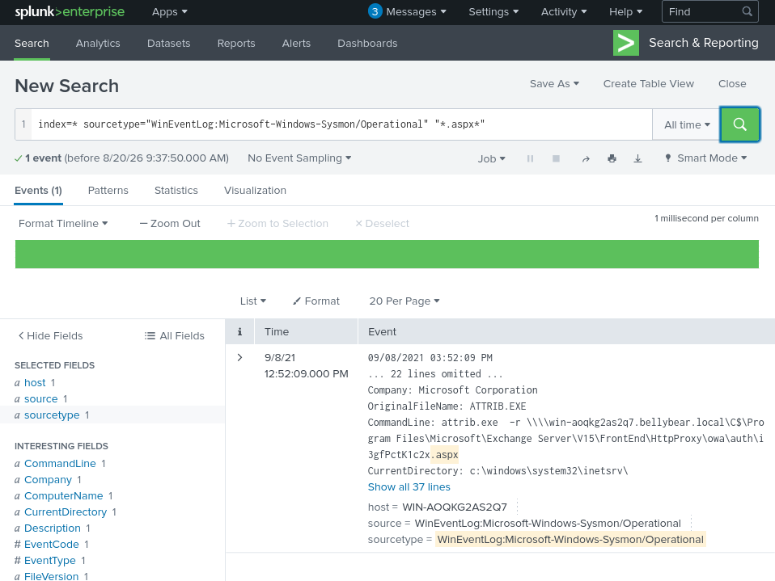
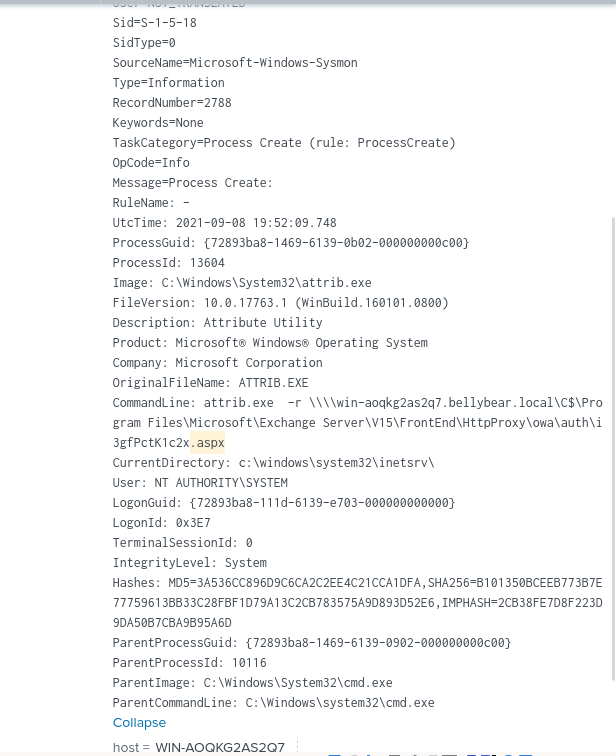

**Q8. What is the web shell the exploit deployed to the system?**
Answer: `i3gfPctK1c2x.aspx` (located at `C:\Program Files\Microsoft\Exchange Server\V15\FrontEnd\HttpProxy\owa\auth\`)

**Q9. What is the command line that executed this web shell?**
Answer: `attrib.exe -r \\win-aoqkg2as2q7.bellybear.local\C$\Program Files\Microsoft\Exchange Server\V15\FrontEnd\HttpProxy\owa\auth\i3gfPctK1c2x.aspx`

---

### Step 7 — Cross-referencing IIS logs

Searched broadly for the web shell filename across all indexed data (not just Sysmon), surfacing IIS log entries showing the actual HTTP POST request that triggered the web shell.

```spl
index=* "i3gfPctK1c2x"
```

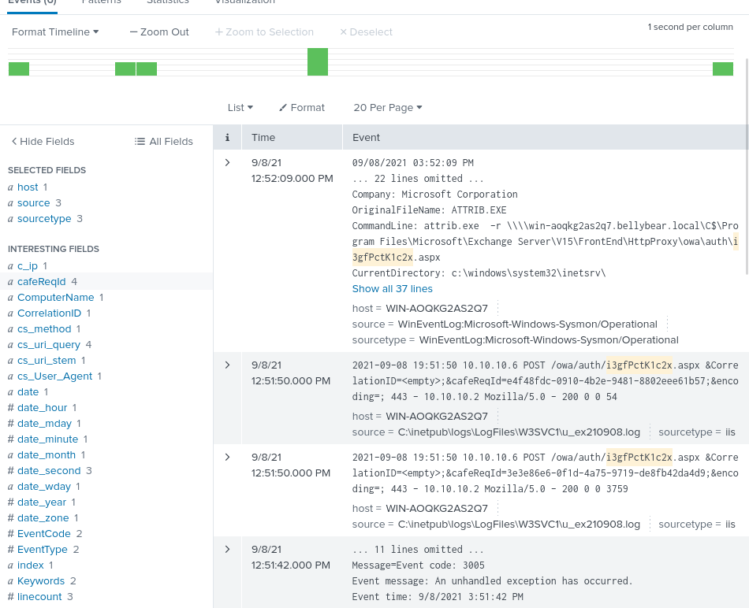

---

### Step 8 — Identify the exploited CVEs

External research was required, since this information is not present in Splunk. Cross-referenced threat intelligence sources describing Conti operators' known exploitation of Fortinet and Microsoft vulnerabilities.

**Q10. What three CVEs did this exploit leverage? (ascending order)**
Answer: `CVE-2018-13374, CVE-2018-13379, CVE-2020-0796`
