# SWS405 Digital Forensics – Assignment 2
## MemLabs Memory Forensics Challenge – Labs 1 to 5

**Royal University of Bhutan · College of Science and Technology · Software Engineering Programme**

|  |  |
|---|---|
| **Student Name** | Pema Tshering Yangchen |
| **Student Number** | 02230295 |
| **Module Tutor** | Pema Thinley |
| **Semester** | Autumn Semester 2026 |
| **Submission Date** | 12 October 2026 |
| **Submission Type** | Individual Assignment |

## Contents

- [1. Introduction](#1-introduction)
- [2. Environment and Setup](#2-environment-and-setup)
- [3. Results at a Glance](#3-results-at-a-glance)
- [4. Lab 1 – Beginner's Luck](#4-lab-1--beginners-luck)
- [5. Lab 2 – A New World](#5-lab-2--a-new-world)
- [6. Lab 3 – The Evil's Den](#6-lab-3--the-evils-den)
- [7. Lab 4 – Obsession](#7-lab-4--obsession)
- [8. Lab 5 – Black Tuesday](#8-lab-5--black-tuesday)
- [9. Conclusion](#9-conclusion)

---

## 1. Introduction

### 1.1 Aim and Scope

The aim of this assignment was to analyse the RAM dumps from the [MemLabs](https://github.com/stuxnet999/MemLabs) challenge (Labs 1–5) with Volatility 2, work out what the user of each machine was doing, and recover the hidden flags. Each lab is a Windows 7 memory image. Lab 6 (optional bonus) was not attempted.

### 1.2 Method

Each lab was worked through the same Part B checklist instead of going straight for a flag. Steps that did not fit a lab's scenario were skipped (for example, hashdump was only needed in Lab 1):

1. **Scope**: identify the OS profile (`imageinfo`).
2. **Processes**: what was running (`pslist`, `pstree`).
3. **Commands and environment**: `cmdscan`, `consoles`, `cmdline`, `envars`.
4. **Files**: what was open or cached (`filescan`, `dumpfiles`, `mftparser`).
5. **Credentials**: `hashdump`.
6. **Deleted data and browser artefacts**: `iehistory`, `chromehistory`, MFT records.

### 1.3 How Each Lab Is Presented

Each lab section has the same five parts:

- **Scenario**: the challenge description and what was expected.
- **Investigation Log**: every command in the order it was run, dead ends included.
- **Findings**: the evidence for each flag, with labelled screenshots.
- **Dead Ends**: what was tried and ruled out.
- **Forensic Reasoning**: why each plugin was the right choice.

*Note on screenshots: every figure is labelled "Figure L.N", where L is the lab number and N the step in that lab's investigation log. Commands in the logs are shown exactly as typed. Long outputs were filtered with grep so the relevant lines are readable; the unfiltered output of the main plugin runs is kept in the memlabs/out/ folder.*

---

## 2. Environment and Setup

All analysis was done on Kali Linux (kernel 7.1.5, zsh shell). The MemLabs images were downloaded from the Mega links in each lab folder of github.com/stuxnet999/MemLabs and extracted with 7-Zip into one folder per lab.

### 2.1 Toolchain

| Tool | Purpose | How it was run |
|---|---|---|
| Volatility 2.6.1 | Memory analysis | Docker container (`python:2.7`) with distorm3 and pycryptodome, plus a wrapper script so it runs as `volatility` |
| superponible/volatility-plugins | `chromehistory` plugin | Passed with `--plugins=$HOME/volatility-plugins` |
| steghide, unrar, sqlite3, exiftool, megatools | Artefact extraction | Debian bookworm container, same wrapper approach |
| KeePassXC | Opening the Lab 2 password database | Native |
| 7-Zip | AES-encrypted ZIP in Lab 2 | Native |

### 2.2 Setup Problems and Fixes

Part A, Option A of the assignment (`sudo apt install volatility`) did not work, because current Kali releases no longer ship either the volatility package or Python 2. The other problems below are recorded because they were part of the real investigation:

| Problem | Fix |
|---|---|
| Debian bullseye container failed: the bullseye security repository returns 404 (end-of-life) | Used `python:2.7` for Volatility and bookworm for the other tools |
| Very slow network (~53 KB/s) | Changed network (~4.8 MB/s) and restarted the downloads |
| megadl rejects Mega's old folder URL format (`#F!id!key`) | Used the new format (`folder/id#key`) |
| In zsh, `P="-f img --profile=X"` is **not** word-split, so `volatility $P ...` failed silently ("The requested file doesn't exist") | Typed the arguments out in full |

### 2.3 Profiles Identified (imageinfo)

| Lab | Image | Profile used |
|---|---|---|
| 1 | MemoryDump_Lab1.raw | Win7SP1x64 |
| 2 | MemoryDump_Lab2.raw | Win7SP1x64 |
| 3 | MemoryDump_Lab3.raw | Win7SP1x86_23418 (32-bit) |
| 4 | MemoryDump_Lab4.raw | Win7SP1x64 |
| 5 | MemoryDump_Lab5.raw | Win7SP1x64 |

In every case I used the first profile that imageinfo suggested for all later commands, as Part A, Step 5 instructs.

---

## 3. Results at a Glance

| Lab | Flag | Key plugin / technique |
|---|---|---|
| 1 – Stage 1 | `flag{th1s_1s_th3_1st_st4g3!!}` | consoles → Base64 decode |
| 1 – Stage 2 | `flag{Good_BoY_good_girL}` | memdump of mspaint.exe → raw pixel render |
| 1 – Stage 3 | `flag{w3ll_3rd_stage_was_easy}` | filescan/dumpfiles + hashdump (NTLM) |
| 2 – Stage 1 | `flag{w3lc0m3_T0_$T4g3_!_Of_L4B_2}` | envars → Base64 decode |
| 2 – Stage 2 | `flag{w0w_th1s_1s_Th3_SeC0nD_ST4g3_!!}` | dumpfiles of .kdbx + Password.png |
| 2 – Stage 3 | `flag{oK_So_Now_St4g3_3_is_DoNE!!}` | chromehistory → Mega → SHA1(Lab 1 flag 3) |
| 3 | `inctf{0n3_h4lf_1s_n0t_3n0ugh}` | cmdline/dumpfiles, XOR reversal, steghide |
| 4 | `inctf{1_is_n0t_EQu4l_7o_2_bUt_th1s_d0s3nt_m4ke_s3ns3}` | mftparser (resident $DATA) |
| 5 – Stage 1 | `flag{!!_w3LL_d0n3_St4g3-1_0f_L4B_5_D0n3_!!}` | iehistory → Base64 filename |
| 5 – Stage 2 | `flag{W1th_th1s_$taGe_2_1s_c0mPL3T3_!!}` | dumpfiles of .rar + Stage 1 flag as password |

**10 of 10 flags recovered.**

---

## 4. Lab 1 – Beginner's Luck

### 4.1 Scenario

*A relative's computer crashed while she was doing several things at once: something in a terminal, trying to draw something, and working with an important archive. Three flags.*

The scenario points to three processes, one per flag: a terminal (cmd.exe), a drawing program (mspaint.exe) and an archive manager (WinRAR.exe).

### 4.2 Investigation Log

```text
$ cd ~/Desktop/SWS405/SWS405_a2/memlabs/Lab1
1.1  $ volatility -f MemoryDump_Lab1.raw imageinfo
        → Win7SP1x64
1.2  $ volatility -f MemoryDump_Lab1.raw --profile=Win7SP1x64 pslist
        → cmd.exe(1984) mspaint.exe(2424) WinRAR.exe(1512) DumpIt.exe(796)
     $ ... pstree / envars
        → nothing unusual (dead end)
1.3  $ ... cmdscan
        → cmd.exe ran "St4G3$1"
1.4  $ ... consoles
        → screen buffer shows Base64 output
1.5  $ echo ZmxhZ3t0aDFzXzFzX3RoM18xc3Rfc3Q0ZzMhIX0= | base64 -d
        → FLAG 1
1.6  $ ... cmdline -p 1512
        → WinRAR opened ...\Documents\Important.rar
1.7  $ ... filescan | grep -i important.rar
        → offset 0x3fa3ebc0
     $ ... dumpfiles -Q 0x000000003fa3ebc0 -D dump/ ; cp file.None.*.dat Important.rar
1.8  $ unrar l Important.rar
        → "Password is NTLM hash (in uppercase) of Alissa's passwd"
1.9  $ ... hashdump
        → Alissa Simpson NT hash f4ff64c8baac57d22f22edc681055ba6
1.10 $ unrar x -pF4FF64C8BAAC57D22F22EDC681055BA6 Important.rar
        → All OK, flag3.png
1.11 $ xdg-open flag3.png
        → FLAG 3
1.12 $ ... memdump -p 2424 -D dump/
        → 2424.dmp (266 MB)
     dead end: rendered the largest all-white regions (0x1b80000, 0x9550000,
               0x3170000) at width 1280 - only blank canvas and icon bitmaps
     dead end: searched for black-on-white 'stroke' blocks - only found fonts
     working:  searched for 64 KB blocks that were ~100% grey and 85-97% white
               = 0xac40000; autocorrelation gave a row stride of 819 pixels
1.13 $ python3 scripts/raw2png.py dump/2424.dmp 0xac20000 819 450 dump/paint.png
        → FLAG 2
```

### 4.3 Findings

#### Triage

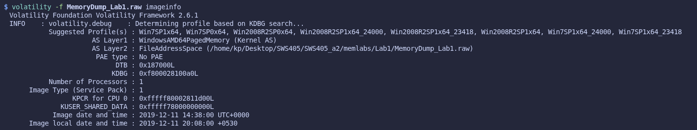

*Figure 1.1 – imageinfo identifies the profile as Win7SP1x64.*

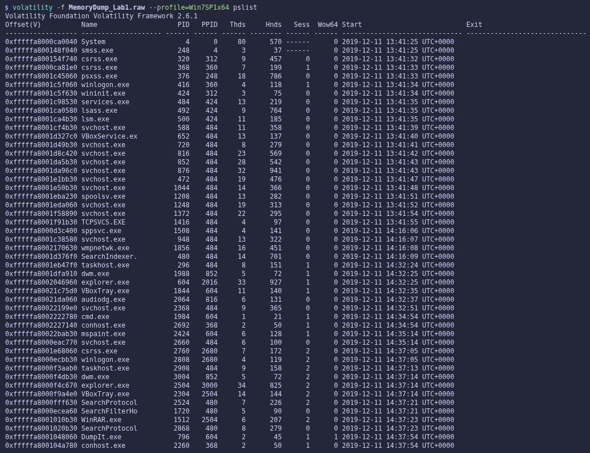

*Figure 1.2 – pslist: the user processes cmd.exe, mspaint.exe and WinRAR.exe, and the acquisition tool DumpIt.exe.*

#### Flag 1: the terminal (cmd.exe)

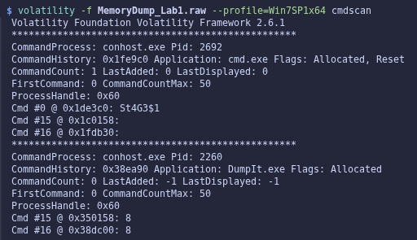

*Figure 1.3 – cmdscan: the command history of cmd.exe contains the command St4G3$1.*

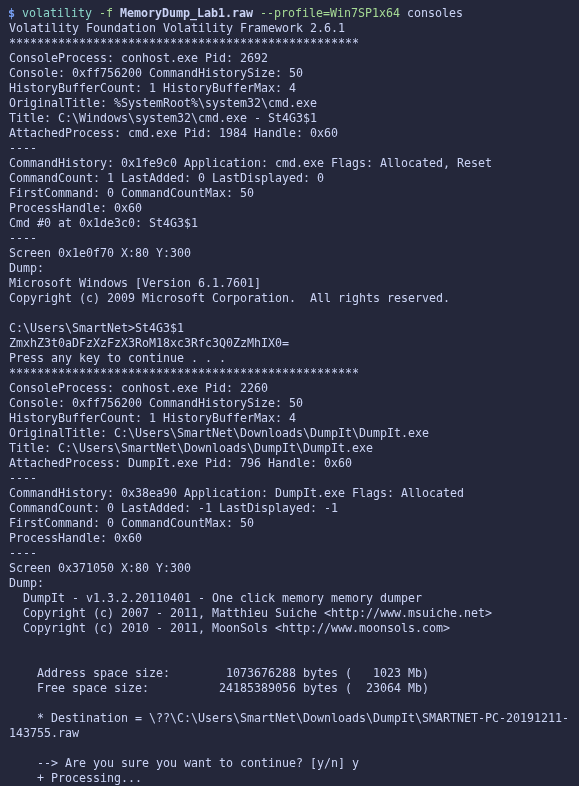

*Figure 1.4 – consoles: the console screen buffer shows the Base64 string printed by St4G3$1.*

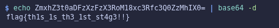

*Figure 1.5 – Decoding the Base64 string reveals Flag 1.*

> **Lab 1 – Flag 1:** `flag{th1s_1s_th3_1st_st4g3!!}`

#### Flag 3: the archive (WinRAR.exe)

This flag was found second; it is shown here in the order of the investigation.

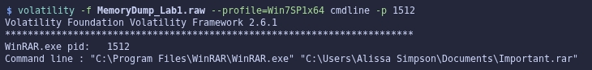

*Figure 1.6 – cmdline of WinRAR.exe (PID 1512) shows the archive that was open: Important.rar.*

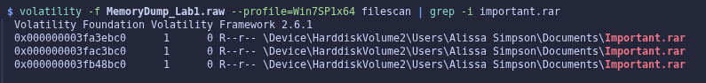

*Figure 1.7 – filescan locates Important.rar in memory and gives its physical offset.*

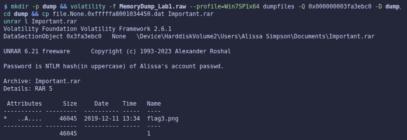

*Figure 1.8 – The extracted archive's comment says the password is Alissa's NTLM hash in uppercase.*

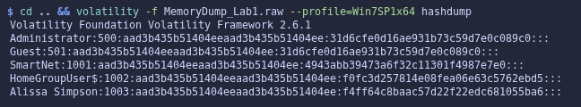

*Figure 1.9 – hashdump recovers the NT hash for the account "Alissa Simpson".*

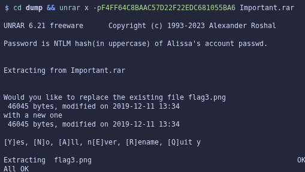

*Figure 1.10 – unrar extracts flag3.png using the uppercase NTLM hash as the password.*

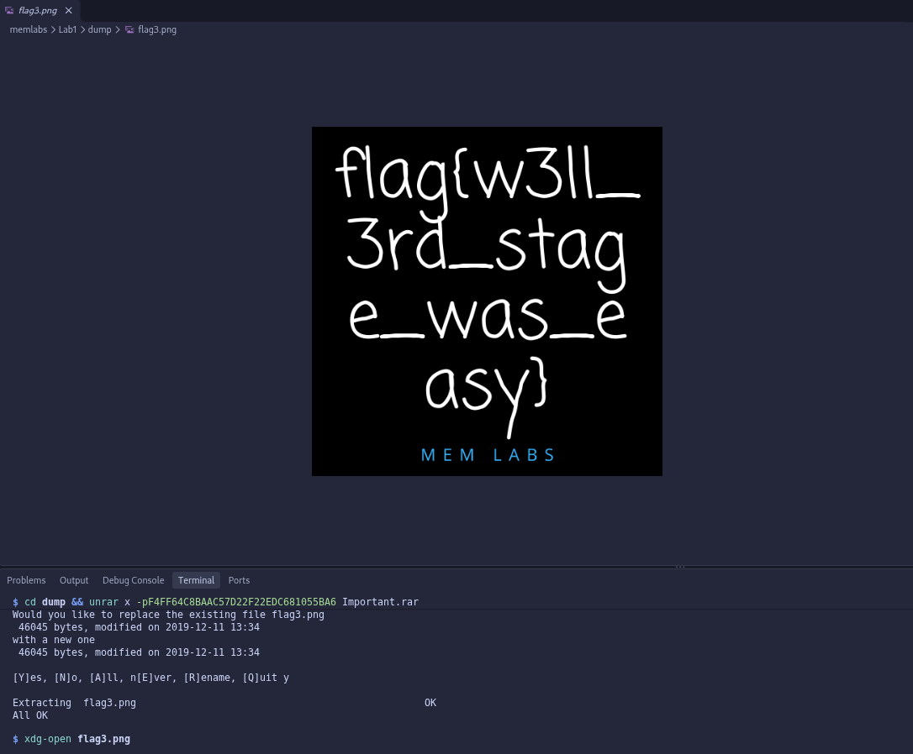

*Figure 1.11 – flag3.png: Flag 3.*

> **Lab 1 – Flag 3:** `flag{w3ll_3rd_stage_was_easy}`

#### Flag 2: the drawing (mspaint.exe)

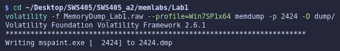

*Figure 1.12 – memdump writes the full address space of mspaint.exe (PID 2424) to 2424.dmp.*

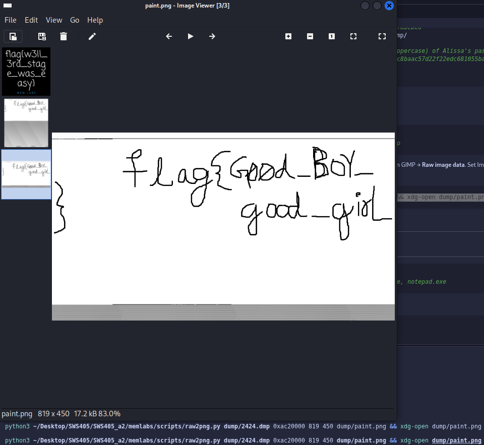

*Figure 1.13 – Raw pixels from 2424.dmp (offset 0xac20000, width 819) rendered as an image: Flag 2.*

> **Lab 1 – Flag 2:** `flag{Good_BoY_good_girL}`

### 4.4 Dead Ends

- **pstree / envars**: nothing unusual.
- **Largest all-white regions of 2424.dmp** (0x1b80000, 0x9550000, 0x3170000) rendered at width 1280: only a blank canvas and icon bitmaps.
- **Searching for black-on-white "stroke" blocks**: only found font bitmaps.
- **What worked**: searching for 64 KB blocks that were ~100% grey and 85–97% white found 0xac40000, and autocorrelation gave a row stride of 819 pixels.

### 4.5 Forensic Reasoning

**Flag 1.** cmd.exe does not keep its own history. The conhost.exe process holds both the command history buffer and the screen buffer in memory. cmdscan only shows what was typed (St4G3$1). consoles also shows what the program printed back, and that is where the encoded flag was.

**Flag 3.** The SAM and SYSTEM registry hives are loaded in RAM, so hashdump can decrypt the NT hashes straight from memory without the hard disk. The archive comment asked for the hash itself, so no password cracking was needed.

**Flag 2.** The drawing had never been saved as a file, so filescan and dumpfiles had nothing to find. The only copy of the picture was the bitmap inside mspaint's own process memory. That is why I had to memdump the process and read the bytes as pixels.

---

## 5. Lab 2 – A New World

### 5.1 Scenario

*An "environmental" activist lost access to his system; his main applications are browsers and password managers. Three flags, one of which depends on a Lab 1 flag.*

### 5.2 Investigation Log

```text
$ cd ~/Desktop/SWS405/SWS405_a2/memlabs/Lab2
     $ volatility -f MemoryDump_Lab2.raw imageinfo
        → Win7SP1x64
2.1  $ ... --profile=Win7SP1x64 pslist
        → chrome.exe (several), KeePass.exe(3008), notepad.exe
     $ ... cmdscan
        → cmd.exe history: "Nothing here kids :)" (dead end)
2.2  $ ... envars | grep NEW_TMP
        → C:\Windows\ZmxhZ3t3M2xjMG0zX1QwXyRUNGczXyFfT2ZfTDRCXzJ9
2.3  $ echo ZmxhZ3t3M2xj...TDRCXzJ9 | base64 -d
        → FLAG 1
2.4  $ ... filescan | grep -iE 'kdbx|password'
        → \Users\SmartNet\Secrets\Hidden.kdbx (0x3fb112a0)
          \Users\Alissa Simpson\Pictures\Password.png (0x3fce1c70)
     $ ... dumpfiles -Q 0x000000003fb112a0 -D dump/ ; dumpfiles -Q 0x000000003fce1c70 -D dump/
2.5  $ xdg-open dump/Password.png
        → small text bottom-right: "password is P4SSw0rd_123"
     dead end: the dumped .kdbx would not open at first ("Data must be padded
               to 16 byte boundary") because dumpfiles pads to a 4096-byte page;
               trimming to the real size (3422 bytes) fixed it
2.6  KeePassXC
        → Hidden.kdbx, master password P4SSw0rd_123 -> Recycle Bin -> 'Sabka Baap'  -> FLAG 2
     (General group entries 'fake', 'fake again', 'oh not again!', 'why God!!' were decoys)
2.7  $ volatility --plugins=$HOME/volatility-plugins ... chromehistory | grep -i mega
        → https://mega.nz/#F!TrgSQQTS!H0ZrUzF0B-ZKNM3y9E76lg
2.8  downloaded Important.zip from the Mega folder
2.9  $ unzip -z Important.zip
        → "Password is SHA1(stage-3-FLAG) from Lab-1. lowercase"
2.10 $ echo -n 'flag{w3ll_3rd_stage_was_easy}' | sha1sum
        → 6045dd90029719a039fd2d2ebcca718439dd100a
     $ 7z x -p6045dd90029719a039fd2d2ebcca718439dd100a Important.zip  (unzip cannot do AES)
2.11 $ xdg-open Important.png
        → FLAG 3
```

### 5.3 Findings

#### Triage

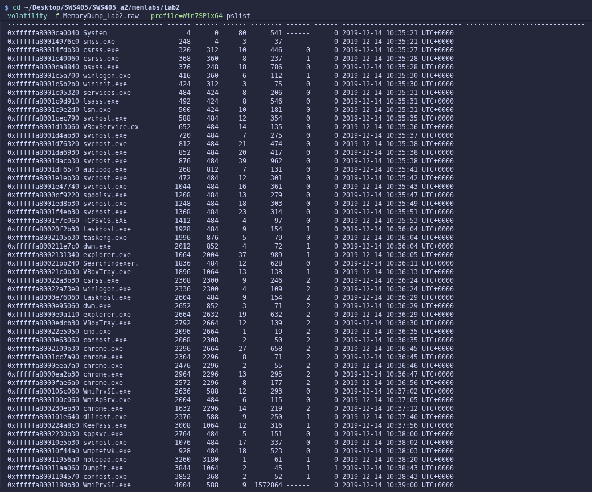

*Figure 2.1 – pslist: Chrome (browser session) and KeePass (password manager) are both running.*

#### Flag 1: environment variables

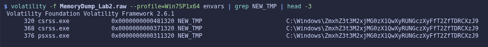

*Figure 2.2 – envars: the custom NEW_TMP variable contains a Base64-looking path in every process.*

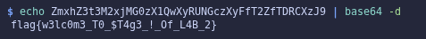

*Figure 2.3 – Decoding the NEW_TMP value gives Flag 1.*

> **Lab 2 – Flag 1:** `flag{w3lc0m3_T0_$T4g3_!_Of_L4B_2}`

#### Flag 2: the password manager

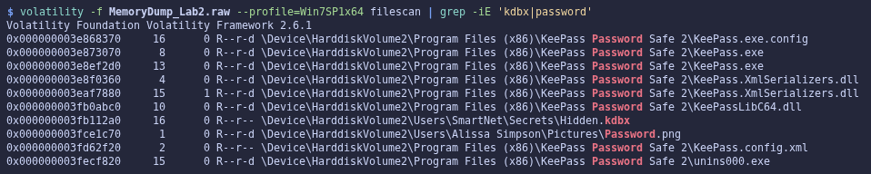

*Figure 2.4 – filescan shows the KeePass database Hidden.kdbx and an image named Password.png.*

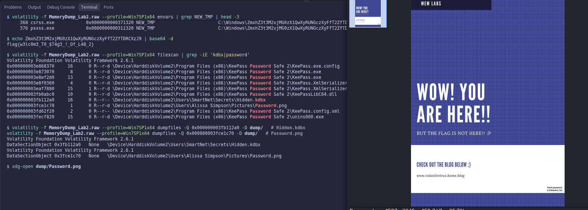

*Figure 2.5 – Password.png extracted from memory. The KeePass master password is hidden in the bottom-right corner.*


*Figure 2.6 – Hidden.kdbx opened in KeePassXC. The deleted entry "Sabka Baap" in the Recycle Bin holds Flag 2.*

> **Lab 2 – Flag 2:** `flag{w0w_th1s_1s_Th3_SeC0nD_ST4g3_!!}`

#### Flag 3: the browser

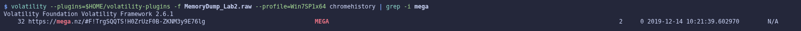

*Figure 2.7 – chromehistory (community plugin): a visited Mega folder link.*


*Figure 2.8 – The Mega folder contains Important.zip.*

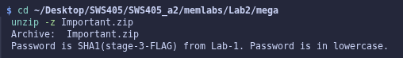

*Figure 2.9 – The ZIP comment explains how to derive the password from the Lab 1 stage-3 flag.*


*Figure 2.10 – SHA1 of the Lab 1 stage-3 flag (lowercase hex) is used to open the AES-encrypted ZIP.*


*Figure 2.11 – Important.png: Flag 3.*

> **Lab 2 – Flag 3:** `flag{oK_So_Now_St4g3_3_is_DoNE!!}`

**Password derivation.** The ZIP comment said "Password is SHA1(stage-3-FLAG) from Lab-1. Password is in lowercase." I took the full Lab 1 stage-3 flag, `flag{w3ll_3rd_stage_was_easy}`, including "flag{" and "}". I hashed it with `echo -n` piped into `sha1sum`; `-n` stops a trailing newline being hashed. sha1sum already prints lowercase hex, so the result `6045dd90029719a039fd2d2ebcca718439dd100a` could be used as is. 7-Zip opened the AES-encrypted ZIP with it; unzip could not, because it does not support AES.

### 5.4 Dead Ends

- **cmdscan**: the cmd.exe history only said "Nothing here kids :)".
- **Dumped .kdbx would not open** ("Data must be padded to 16 byte boundary"). dumpfiles pads the output to a 4096-byte page; trimming it to the real size (3422 bytes) fixed it.
- **KeePass decoys**: the General group entries 'fake', 'fake again', 'oh not again!' and 'why God!!' held no flag.

### 5.5 Forensic Reasoning

**Flag 1.** Every process keeps a copy of its environment block in its Process Environment Block (PEB) in memory. A variable set system-wide therefore shows up for every process, which made the unusual NEW_TMP value easy to spot.

**Flag 2.** filescan finds file objects that the system has open or cached, and dumpfiles rebuilds them from cached pages. This gave both the password database and the image containing its master password. The flag was in the KeePass Recycle Bin: "deleting" an entry in an application only moves it there, and the data stays until the bin is emptied.

**Flag 3.** The community chromehistory plugin parses Chrome's SQLite History database from memory, which revealed the external Mega link.

---

## 6. Lab 3 – The Evil's Den

### 6.1 Scenario

*A malicious script encrypted a secret on the system. One flag, split into two halves; the first half is needed to get the second (Note-2).*

### 6.2 Investigation Log

```text
$ cd ~/Desktop/SWS405/SWS405_a2/memlabs/Lab3
3.1  $ volatility -f MemoryDump_Lab3.raw imageinfo
        → Win7SP1x86_23418 (32-bit image, different from other labs)
     $ ... --profile=Win7SP1x86_23418 pslist
        → two notepad.exe processes (3736, 3432)
3.2  $ ... cmdline | grep -i -A1 notepad
        → notepad opened Desktop\evilscript.py and Desktop\vip.txt
3.3  $ ... filescan | grep -iE 'evilscript|vip.txt|\.jpe?g' | grep -vE 'Windows|Python27'
        → evilscript.py.py (0x3de1b5f0), vip.txt (0x3e727e50), suspision1.jpeg (0x04f34148)
     dead end: first dumpfiles attempts printed "The requested file doesn't
               exist" - my zsh $P variable was not word-split; typing the
               arguments out in full fixed it
     $ ... dumpfiles -Q 0x000000003de1b5f0 / 0x000000003e727e50 / 0x0000000004f34148 -D dump/
     $ cp the file.None.*.dat outputs to evilscript.py, vip.txt and suspision1.jpeg
3.4  $ cat evilscript.py
        → XOR every char with 3, then base64, write to vip.txt
3.5  $ cat vip.txt
        → am1gd2V4M20wXGs3b2U=
3.6  $ python3 reverse_evilscript.py vip.txt
        → inctf{0n3_h4lf        (first half)
3.7  $ steghide extract -sf suspision1.jpeg -p 'inctf{0n3_h4lf'
        → wrote "secret text"
3.8  $ cat "secret text"
        → _1s_n0t_3n0ugh}                         (second half)
```

### 6.3 Findings

#### Triage

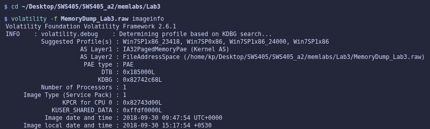

*Figure 3.1 – imageinfo: this image is 32-bit (Win7SP1x86_23418).*

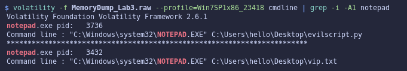

*Figure 3.2 – cmdline: notepad.exe had evilscript.py and vip.txt open.*

#### First half: reversing the malicious script

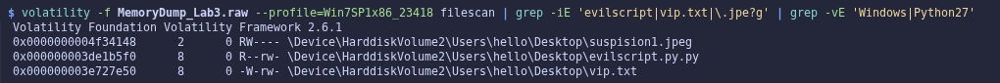

*Figure 3.3 – filescan: the script, its output file and the out-of-place image suspision1.jpeg.*

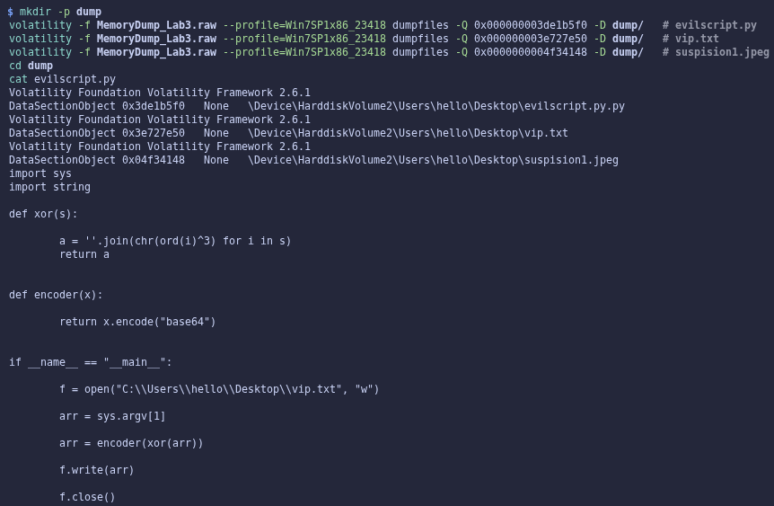

*Figure 3.4 – The recovered evilscript.py.*

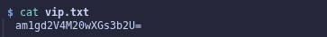

*Figure 3.5 – The script's output, vip.txt.*

**What the script does.** evilscript.py takes the secret from its first command-line argument (`sys.argv[1]`). Its `xor()` function replaces every character with `chr(ord(c) ^ 3)`, which XORs each byte with the key 3. The result is Base64-encoded with `x.encode("base64")` and written to `C:\Users\hello\Desktop\vip.txt`. So:

> vip.txt = Base64( XOR3(secret) )

**How I reversed it.** I undid the steps in the opposite order: Base64-decode vip.txt, then XOR every byte with 3 again. XOR is its own inverse ((x ^ 3) ^ 3 = x), so the same key restores the original text.

```python
import base64, sys
data = open(sys.argv[1], 'rb').read().rstrip(b'\x00').strip()     # dumpfiles pads with NUL bytes
print(''.join(chr(b ^ 3) for b in base64.b64decode(data)))
```

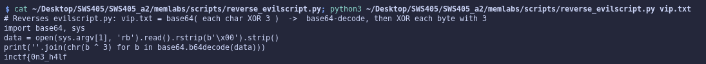

*Figure 3.6 – My reversing script and its output: the first half of the flag.*

#### Second half: steganography

filescan listed several images, but only suspision1.jpeg had an unusual name and sat on the user's Desktop. steghide needs a passphrase. Note-2 says the first half is needed to get the second, so I tried the first half itself, `inctf{0n3_h4lf`, and it worked first time.

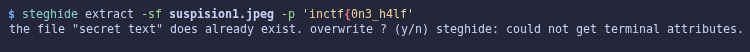

*Figure 3.7 – steghide extracts hidden data from suspision1.jpeg using the first half as the passphrase.*

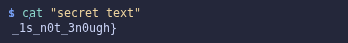

*Figure 3.8 – The extracted "secret text": the second half of the flag.*

> **Lab 3 – Flag:** `inctf{0n3_h4lf_1s_n0t_3n0ugh}`

### 6.4 Dead Ends

- **dumpfiles printed "The requested file doesn't exist"**: this was the zsh word-splitting problem from Section 2.2, not missing data. Typing the arguments out in full fixed it.

### 6.5 Forensic Reasoning

cmdline was the key starting point. A process's full command line is stored in its PEB, so the paths of the files notepad had opened were still recorded in memory even after the files were closed. filescan and dumpfiles then recovered the file contents from the Windows file cache, without needing the disk. Reading the script instead of just running it meant I could explain the exact transformation and reverse it reliably.

---

## 7. Lab 4 – Obsession

### 7.1 Scenario

*The user was obsessed with an important file and the system crashed; at least one Desktop file was deleted. One flag.*

### 7.2 Investigation Log

```text
$ cd ~/Desktop/SWS405/SWS405_a2/memlabs/Lab4
     $ volatility -f MemoryDump_Lab4.raw imageinfo
        → Win7SP1x64
     $ ... pslist / cmdline
        → nothing suspicious, DumpIt only
4.1  $ ... filescan | grep -iE 'Desktop\\[^\\]+\.(txt|jpe?g|png)$'
        → eminem\Desktop\galf.jpeg, eminem\Desktop\Screenshot1.png,
          SlimShady\Desktop\Important.txt
     DEAD END (steganography on the suspicious image 'galf' = 'flag' reversed):
     $ ... dumpfiles -Q 0x000000003e8ad250 -D dump/ ; cp ... galf.jpeg
4.2  $ steghide extract -sf galf.jpeg -p '' && cat LMAO.txt
        → "Move on bro, there is nothing here :)"
     $ exiftool galf.jpeg ; strings galf.jpeg | grep -i inctf
        → nothing
4.3  $ ... dumpfiles -Q 0x000000003fc398d0 -D dump/ ; ls dump
        → no file written for Important.txt
4.4  $ ... mftparser > mft.txt ; grep -n -B22 -A15 'Desktop\\Important.txt' mft.txt
        → MFT record 60583, resident $DATA: i..n..ct..f{1.._is.._n0t.._EQu4l...
4.5  removed the 0d 0a (CR LF) bytes from the $DATA content
        → FLAG
```

### 7.3 Findings

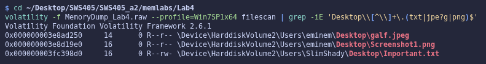

*Figure 4.1 – filescan of the Desktop folders: galf.jpeg, Screenshot1.png and Important.txt.*

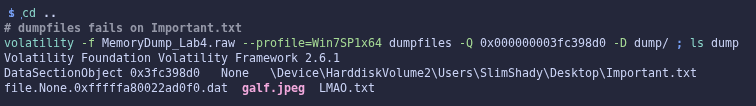

*Figure 4.3 – dumpfiles on Important.txt writes nothing, even though filescan lists the file.*

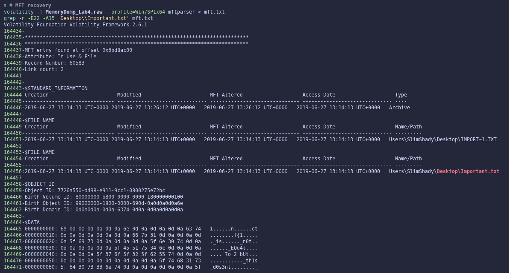

*Figure 4.4 – mftparser: MFT record 60583 for Important.txt, with its content stored in the resident $DATA attribute.*


*Figure 4.5 – The flag rebuilt from the $DATA bytes after removing the CR/LF characters.*

> **Lab 4 – Flag:** `inctf{1_is_n0t_EQu4l_7o_2_bUt_th1s_d0s3nt_m4ke_s3ns3}`

### 7.4 Dead Ends

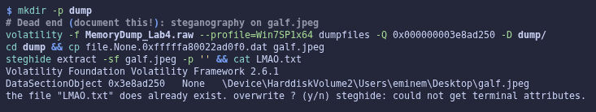

*Figure 4.2 – Dead end: steghide on galf.jpeg (empty passphrase) only gives LMAO.txt, "Move on bro".*

- **pslist / cmdline**: nothing suspicious apart from DumpIt.
- **galf.jpeg** ("flag" spelled backwards) looked like the obvious target. steghide, exiftool and strings only produced a joke message.

**Why this dead end still counts.** Documenting it is good forensic practice. It shows that a likely hiding place was considered and ruled out. Another investigator can reproduce the result instead of repeating the work. It also explains why the investigation moved on to the MFT. A report that only showed the successful step would hide how the conclusion was reached.

### 7.5 Forensic Reasoning: Why dumpfiles Failed but mftparser Succeeded

- **filescan** finds FILE_OBJECT structures in kernel pool memory. It can still list a file whose object was left behind after the file was closed or deleted.
- **dumpfiles** does not read the file from disk. It can only rebuild a file from data pages that the Windows cache manager still holds in RAM (the DataSectionObject, ImageSectionObject or SharedCacheMap). For Important.txt those pages were gone, so there was nothing to write out.
- **mftparser** reads the NTFS Master File Table. Each file has a 1 KB MFT record, and when a file is very small (roughly under 700 bytes) NTFS stores its contents inside that record as a resident $DATA attribute instead of in separate clusters. The MFT record for Important.txt was still in memory, so mftparser could print the file's content even though the file could not be dumped.
- **Was the file actually deleted?** mftparser marks record 60583 as `In Use & File`, so at the time of the capture Important.txt itself had not been deleted. The scenario's "at least one Desktop file was deleted" comes from the challenge text. What made the file hard to recover was not deletion but that its data pages had dropped out of the cache.

In short, a file being listed does not mean its data can be recovered. You have to look for another copy of the data, and for small files the MFT is that copy.

---

## 8. Lab 5 – Black Tuesday

### 8.1 Scenario

*The user's system crashed after something happened while working; an archive manager was in use. Two flags; the first unlocks the second. README Note-2: change "_L4B_3_D0n3_!!" to "_L4B_5_D0n3_!!".*

### 8.2 Investigation Log

```text
$ cd ~/Desktop/SWS405/SWS405_a2/memlabs/Lab5
     $ volatility -f MemoryDump_Lab5.raw imageinfo
        → Win7SP1x64
5.1  $ ... --profile=Win7SP1x64 pslist
        → WinRAR.exe(2924), several NOTEPAD.EXE + WerFault.exe
5.2  $ ... cmdline -p 2924
        → WinRAR opened ...\Documents\SW1wb3J0YW50.rar
5.3  $ ... filescan | grep -i '\.rar'
        → offset 0x3eed56f0
     $ ... dumpfiles -Q 0x000000003eed56f0 -D dump/ ; cp dump/file.None.*.dat dump/SW1wb3J0YW50.rar
5.4  $ unrar l dump/SW1wb3J0YW50.rar
        → Stage2.png, encrypted (*), needs a password
     note: 'SW1wb3J0YW50' is Base64 for 'Important'
     $ volatility --plugins=... chromehistory
        → empty table, no Chrome history (dead end)
5.5  $ ... iehistory | grep -i ZmxhZ3
        → 6 hits: ...MNEJfM19...bmp (once, Pictures\) and ...MNEJfNV9...bmp
          (five times, Pictures\ and C:\Windows\AppPatch\)
5.6  $ echo ZmxhZ3shIV93M0xMX2QwbjNfU3Q0ZzMtMV8wZl9MNEJfM19EMG4zXyEhfQ== | base64 -d
        → flag{!!_w3LL_d0n3_St4g3-1_0f_L4B_3_D0n3_!!}  (L4B_3 version)
     note: the other five hits differ only in 'M19' -> 'NV9', i.e. '3_' -> '5_',
           so they decode to ..._L4B_5_D0n3_!!}, which Note-2 confirms  -> FLAG 1
5.7  $ unrar x -p'flag{!!_w3LL_d0n3_St4g3-1_0f_L4B_5_D0n3_!!}' dump/SW1wb3J0YW50.rar dump/
        → All OK
5.8  $ xdg-open dump/Stage2.png
        → FLAG 2
```

### 8.3 Findings

#### Triage and the locked archive

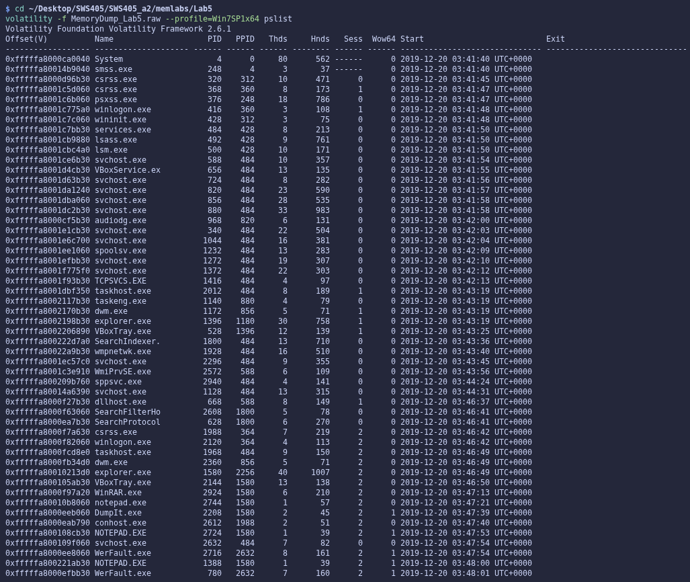

*Figure 5.1 – pslist: WinRAR.exe is running; notepad crashes (WerFault.exe) but nothing is obviously malicious.*

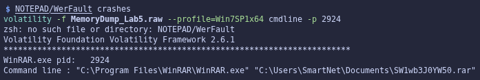

*Figure 5.2 – cmdline of WinRAR.exe: the archive SW1wb3J0YW50.rar was open.*

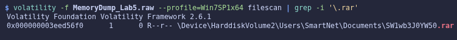

*Figure 5.3 – filescan locates SW1wb3J0YW50.rar and its offset.*

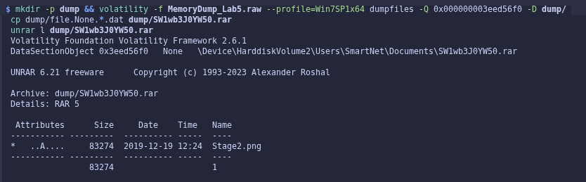

*Figure 5.4 – The dumped archive contains an encrypted Stage2.png.*

#### Flag 1: browsing history

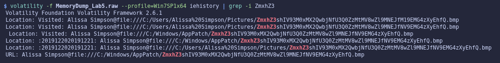

*Figure 5.5 – iehistory: six visited .bmp files with long Base64 filenames. The first hit encodes the L4B_3 version of the flag; the other five encode the L4B_5 version.*

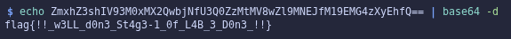

*Figure 5.6 – Decoding the first hit gives the L4B_3 version of the stage-1 flag.*

**Two versions of the flag.** Memory holds two different filenames. The first hit, in `Pictures\`, decodes to `..._L4B_3_D0n3_!!}`; the other five, in `Pictures\` and `C:\Windows\AppPatch\`, differ only in `M19` → `NV9` (`3_` → `5_`) and decode to `..._L4B_5_D0n3_!!}`. The L4B_3 entry appears only once, while the L4B_5 version appears in both folders. The README's Note-2 ("change _L4B_3_D0n3_!! to _L4B_5_D0n3_!!") confirms that L4B_5 is the correct flag, and it is the one that opens the archive (Figure 5.7).

> **Lab 5 – Flag 1:** `flag{!!_w3LL_d0n3_St4g3-1_0f_L4B_5_D0n3_!!}`

#### Flag 2: unlocking the archive

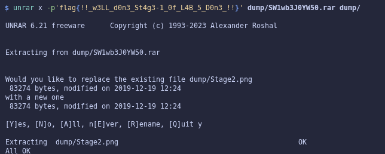

*Figure 5.7 – The stage-1 flag is the password that extracts Stage2.png.*

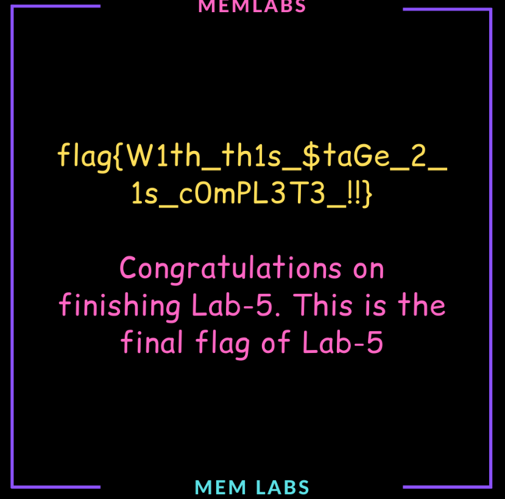

*Figure 5.8 – Stage2.png: Flag 2.*

> **Lab 5 – Flag 2:** `flag{W1th_th1s_$taGe_2_1s_c0mPL3T3_!!}`

### 8.4 Dead Ends

- **chromehistory**: empty table; Chrome was not used on this machine. (This output was not saved to memlabs/out/.)

### 8.5 Forensic Reasoning

**Finding the archive.** cmdline and filescan located the archive the same way as in Lab 1. This time, though, the password was not a credential stored by Windows.

**Choice of browser-history plugin.** Because the process list showed nothing malicious, the next step was to widen the search to browsing history. I used the built-in iehistory plugin. This system's history is held in Internet Explorer's WinINet index.dat cache files, which also record file:// paths opened through Explorer. The chromehistory plugin used in Lab 2 only parses Google Chrome's SQLite History database, which does not exist on this machine.

**Spotting the flag.** Long filenames starting with "ZmxhZ3" (Base64 for "flag{") stood out among the normal URLs. Two versions of the filename were recorded; the L4B_5 version, confirmed by Note-2, was the first flag and also the archive password.

---

## 9. Conclusion

All ten flags from Labs 1–5 were recovered from the memory images alone. The same lesson came up in every lab: RAM holds far more than the list of running processes. The table below shows which memory artefact gave up each lab's evidence.

| Memory artefact | Plugin | Lab(s) |
|---|---|---|
| Console history and screen buffers (conhost.exe) | cmdscan, consoles | 1 |
| Process command lines (PEB) | cmdline | 1, 3, 5 |
| Environment variables (PEB) | envars | 2 |
| Cached copies of files | filescan, dumpfiles | 1, 2, 3, 5 |
| Registry hives with password hashes | hashdump | 1 |
| Process address space (unsaved bitmap) | memdump | 1 |
| Browser history | chromehistory, iehistory | 2, 5 |
| MFT records (resident file data) | mftparser | 4 |

I worked through the Part B checklist instead of jumping straight to the flag. Because of that, dead ends such as the Lab 4 decoy image were recognised quickly and documented, and every flag can be traced back to a specific plugin and artefact shown in the figures above.
